# WILDBOUND — 描画更新の記録

2026-10-24。既存ゲームを実際に起動し、昼・森・山・湖・夕方・夜・水中・洞窟・インベントリを撮影してから実装しました。方向性は、暖かな日光、冷たい陰影、翡翠色の湖を持つ自然なボクセルの世界です。

## ゲーム内の映像

すべて実際のWebGL描画です。比較にはシード `wildbound` を使用し、ブラウザでカメラ・時刻・天候を固定しています。洞窟の灯りと小屋は既存ブロックを使う検証用の配置です。画像に後処理を加えていません。

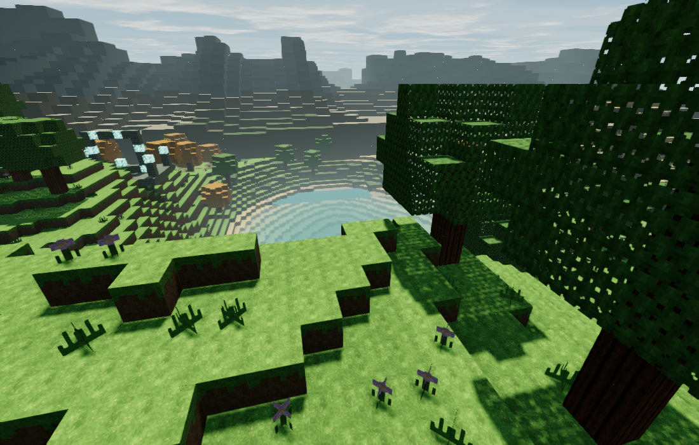

| 変更前の水辺 | 変更後の水辺 |
| --- | --- |
| 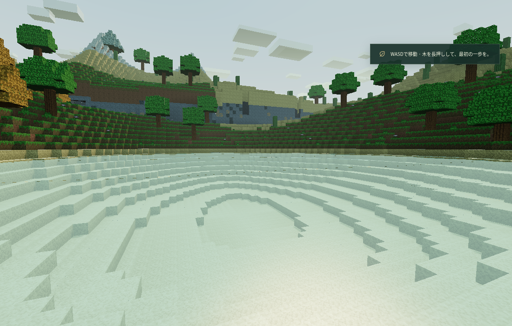 | 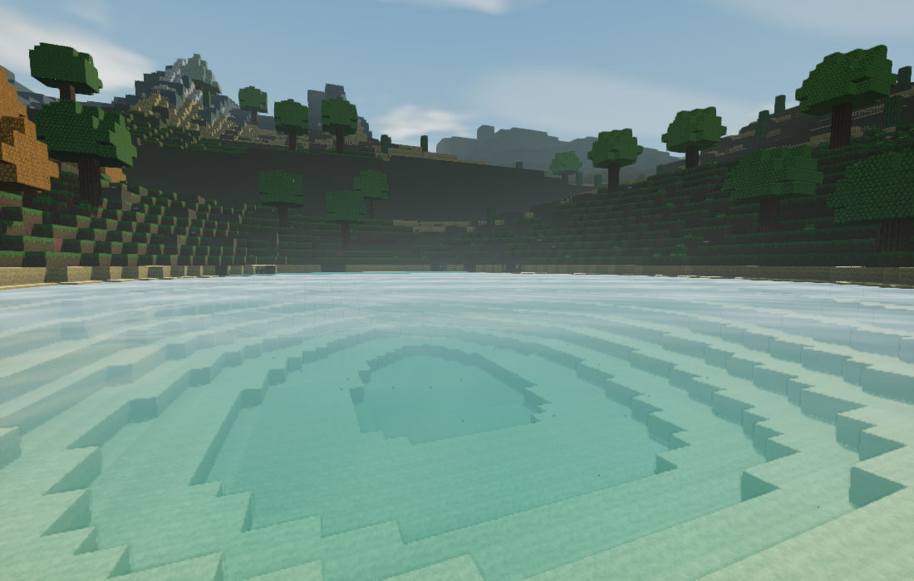 |

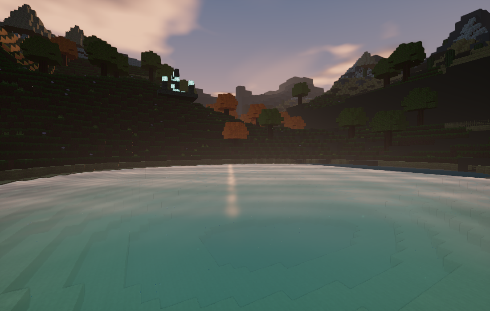

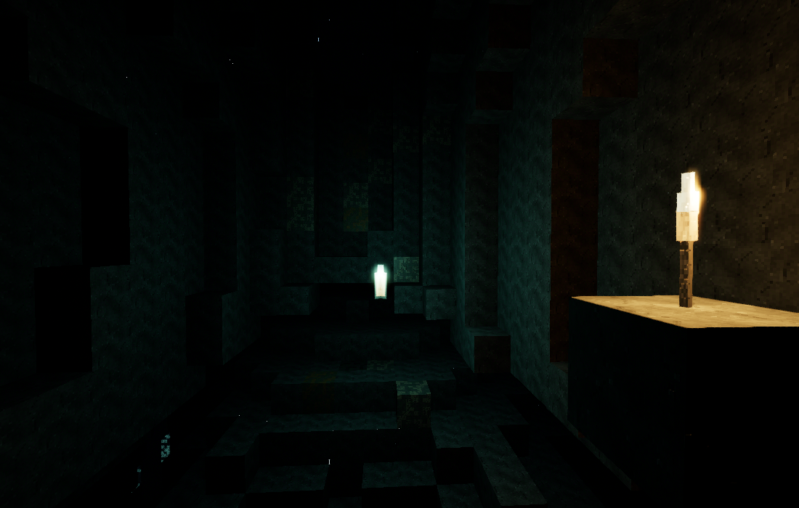

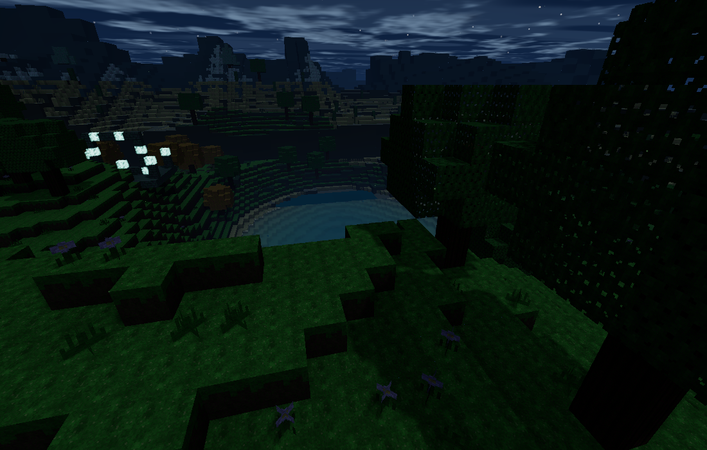

| 森林 | 山岳 |
| --- | --- |
| 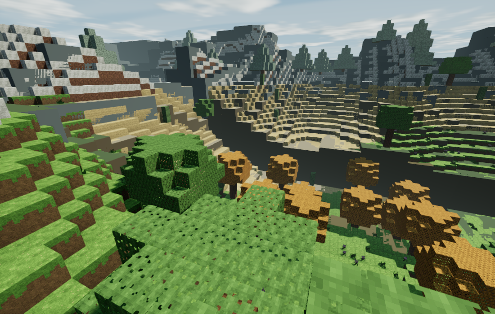 | 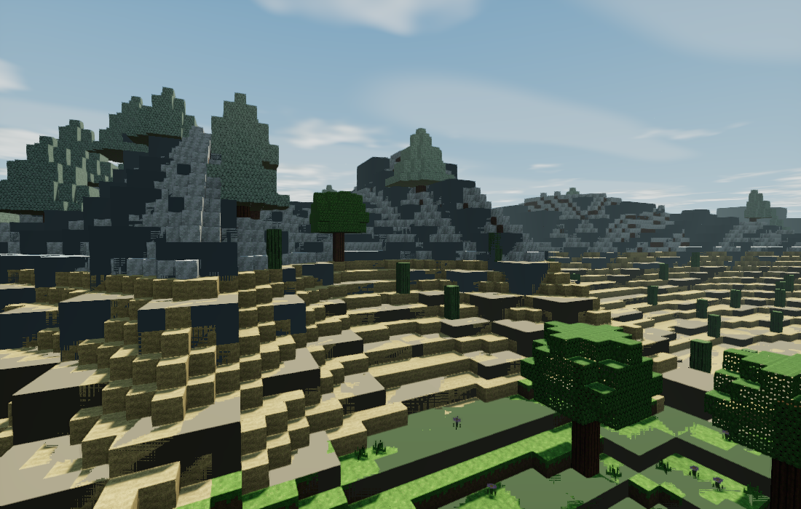 |

| 水中 | 雨 |
| --- | --- |
| 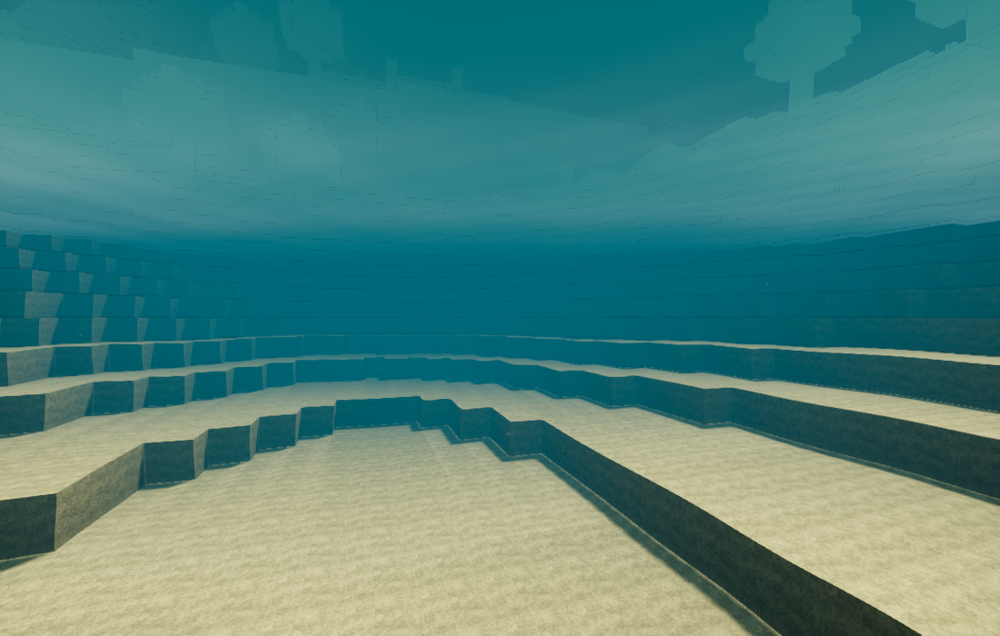 | 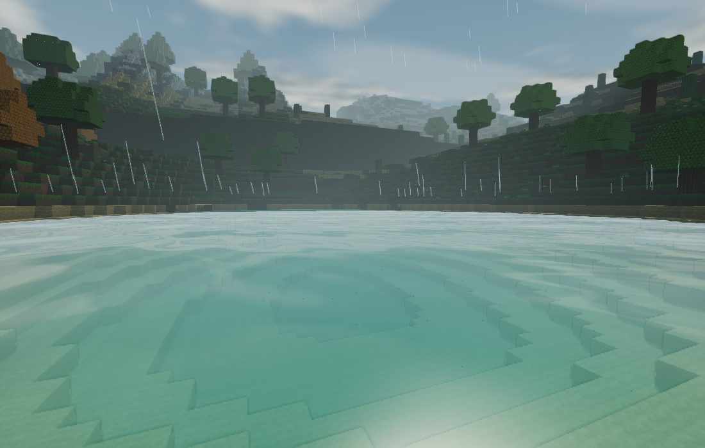 |

| ブロックで建てた小屋 | インベントリ |
| --- | --- |
| 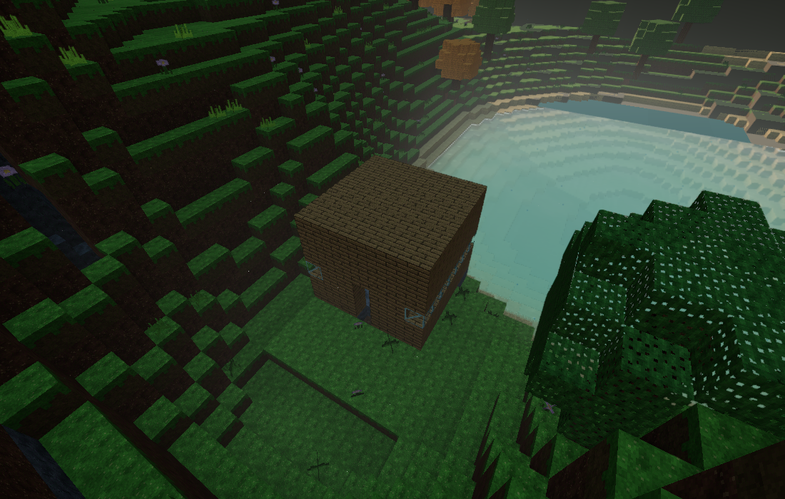 | 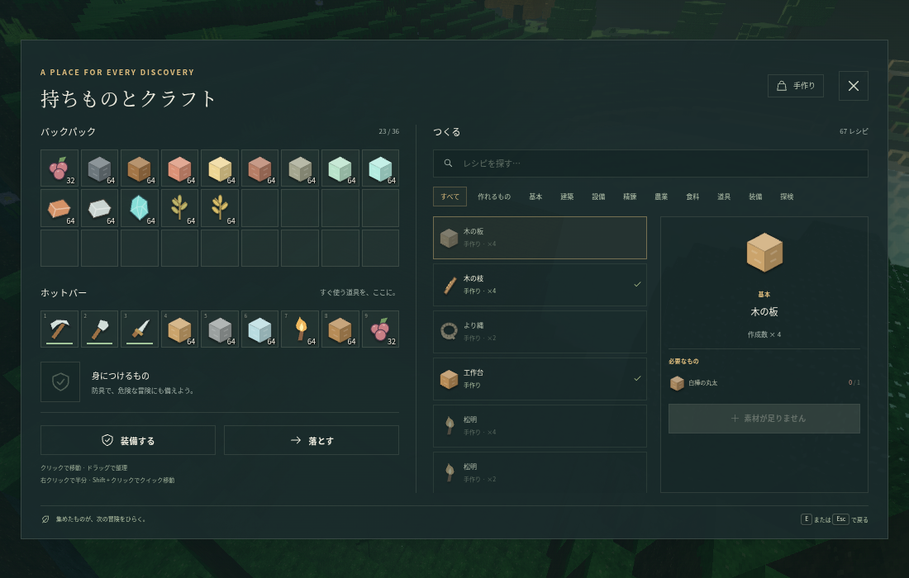 |

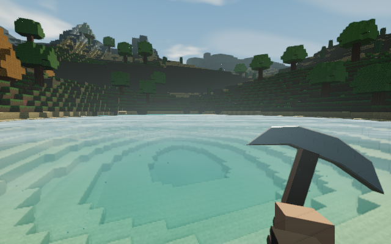

## 実装と反復

- 環境光を一様に強く照らす状態から、暖かな方向光と冷たい空・地面の環境光へ変更。夜は月明かりへ移り、洞窟では環境光を減衰させます。
- 影は画質に応じて解像度と範囲を変え、光の座標系で投影位置をテクセル単位に固定します。単一の方向光シャドウです。CSMではありません。
- 箱の雲を廃止し、空の光環、夕焼け、月、星と、方向別の密度差で厚みを近似する雲を一つの空シェーダーへ統合。夕方の星の出現時刻も画像を見て修正しました。
- 水は連続する波の法線、フレネル、空と雲・太陽・月の反射を使用。高画質以上では水を除いたシーンの色と深度から、屈折、吸収、岸の泡を描きます。実際の地形の鏡面反射やSSRは使っていません。
- Greedy Meshingの水面で頂点を上下させるとT字の接続部が割れたため、水の頂点高さを揃え、波はピクセル単位の法線に集約しました。
- ブロックごとの手続きテクスチャを16pxから32pxへ。岩、鉱石、木目、土、葉の模様を分け、粗さ・鉱物の反射・微細な凹凸・発光マスク・葉の透過光の近似を追加。洞窟画像で強すぎた凹凸を弱めました。
- 葉と草の風を地形と影の両シェーダーに適用。雨の線、環境の微粒子、濡れた面の暗さと粗さを追加。
- 遠景は同じシードの地形を使う表示専用LOD。最初の滑らかな三角形の山は画風に合わなかったため、段状のボクセルへ作り直しました。ブロック生成・当たり判定・セーブ形式に変更はありません。
- 高画質以上で線形HDR中間バッファ、接触陰影、谷の霞、控えめなブルーム、FXAAを使用。ACESとsRGB変換は最終出力に一度だけ適用します。水中では色・霧・小さな歪みが変化します。
- 一人称の道具を種類別の形状へ変更。水の後ろに手が消える問題も、透明オブジェクトとの描画順を修正しました。

## 画質と互換性

| 設定 | 影 | 画面効果 | 水の屈折 | 遠景LOD |
| --- | --- | --- | --- | --- |
| 低 | なし | なし、専用の軽量地形シェーダー | なし | なし |
| 標準 | 1024px | なし | なし | なし |
| 高 | 2048px | HDR・FXAA・接触陰影・ブルーム | 半解像度 | 約288m |
| Ultra | 3072px | 上記＋対応時2x MSAA | 3/4解像度 | 約320m |
| Cinematic | 4096px | 上記＋対応時4x MSAA | 等解像度 | 約352m |

高画質の水の深度取得は、水が視錐台に入る場合だけ実行します。ブルームは1/4解像度です。自動調整が有効なときは、解像度を下げても負荷が高い場合に標準相当の効果へ切り替えます。選択した画質を固定して撮影する場合は自動調整をオフにしてください。

MSAAは色と深度の内部フォーマットが共通で対応するサンプル数に制限します。描画バッファの完全性を検証し、必要ならRGBA8、さらに直接描画へフォールバックします。低画質へ切り替えると高画質用GPUバッファを解放します。

これは実時間GI、レイトレーシング、完全な体積雲・流体シミュレーションではありません。見た目と互換性のため、散乱、間接光、雲の厚み、水中の光は限定した近似を使っています。

## 検証

`npm test`、`npm run test:e2e`、`npm run test:features`、`npm run test:graphics`、`npm run test:standalone`、`npm run build`、`npm run format:check` を使用します。ブラウザテストはこの環境のChromiumとSwiftShaderで実行し、画像とJSONの結果を `artifacts/` に残します。

実GPUはこのクラウド環境で利用できません。ソフトウェア描画で起動・機能・シェーダー・画質切り替えを検証しており、一般的なPCのFPSは未検証です。GPU読戻しで同期するテストの結果も、実機のゲームプレイFPSには換算しません。Cinematicは性能より映像品質を優先する設定です。

同期描画＋GPU読出しの中央値（640×400、固定した水辺、SwiftShader、各3回）は、低62.8ms、標準148.8ms、高260.8ms、Ultra293.2ms、Cinematic444.3msでした。読出しによる同期負荷を含む値で、実GPUの目標FPSを示すものではありません。[検証記録](graphics/verification.json) にプリセット・バッファ切替の結果を残しています。

最終確認では単体67項目、主要ゲームプレイ17項目、設備など8項目、単一HTML8項目が成功しました。画像では11シーンとインベントリ、5段階の画質、6種類のバッファ切替・フォールバック、7種類の手持ち表示を確認しています。コンソール／ページエラーは0件でした。
